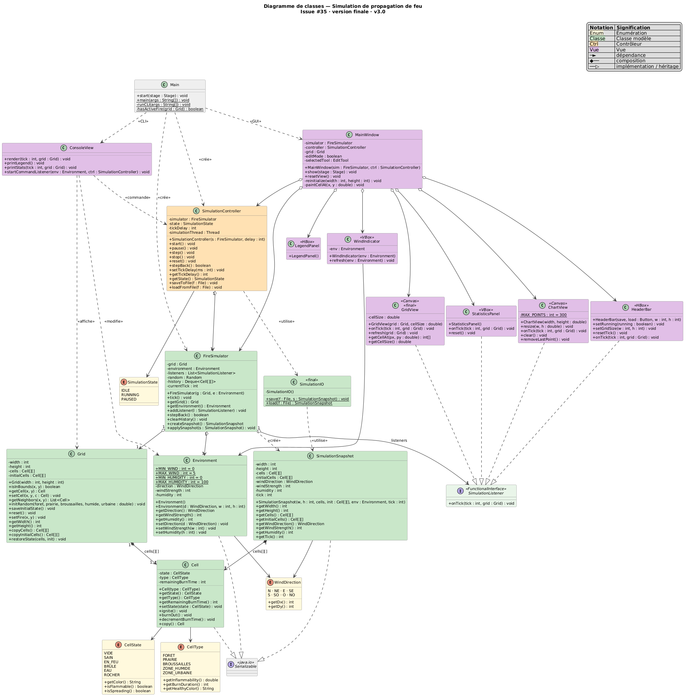

# SimCel — Simulation de Propagation de Feu

Automate cellulaire 2D simulant la propagation d'un incendie dans un environnement naturel, avec interface graphique JavaFX et mode console headless.

Projet réalisé dans le cadre du cours de Génie Logiciel — cursus ingénieur informatique (CY Tech).

---

## Fonctionnalités

### Simulation

- Grille 2D paramétrable avec 6 états de cellule : `VIDE`, `SAIN`, `EN_FEU`, `BRÛLÉ`, `EAU`, `ROCHER`
- 5 types de terrain avec inflammabilité et durée de combustion propres (forêt, prairie, broussailles, zone humide, zone urbaine)
- Paramètres environnementaux : vent (8 directions, intensité 0–5) et humidité (0–100 %)
- Propagation stochastique avec double-buffering (décisions basées sur un snapshot figé)
- Historique des 100 derniers états pour reculer tick par tick (`step back`)

### Contrôle

- Démarrer / Pause / Pas avant / Pas arrière / Reset (retour à l'état initial)
- Vitesse de simulation ajustable (délai entre deux ticks, de 50 à 1000 ms)
- Nouvelle grille aux dimensions choisies (largeur 10–300, hauteur 10–200)
- Sauvegarde et chargement d'une simulation (format binaire `.simcel`)

### Interface graphique (JavaFX)

- Rendu de la grille sur Canvas avec zoom (×0.2 à ×8, centré sur le curseur) et panoramique (clic-glisser)
- Mode édition avec 9 outils : forêt, prairie, broussailles, zone humide, zone urbaine, effacer (vide), eau, rocher et foyer (allume un feu), appliqués à la souris sur n'importe quelle cellule
- Statistiques en temps réel : tick, compteurs SAIN / EN_FEU / BRÛLÉ, taux de destruction
- Courbe d'évolution dynamique (3 séries, fenêtre glissante de 300 points)
- Indicateur de vent : boussole animée, force et humidité
- Légende des types de terrain

### Mode console (headless)

- Rendu ANSI dans le terminal
- Commandes interactives pendant la simulation : `wind <direction> <force>` (ex. `wind NE 3`), `humidity <0–100>`, `speed <ms>`, `help`
- La simulation s'arrête d'elle-même au bout de `--ticks` ticks ou quand plus aucune cellule ne brûle

---

## Prérequis

- Java 21
- Maven 3.8+
- JavaFX 21 (géré automatiquement via Maven)

---

## Installation

```bash
git clone https://github.com/rmouahid/simcel.git
cd simcel
mvn compile        # télécharge les dépendances (JavaFX, JUnit) au premier lancement
```

Aucune autre installation n'est nécessaire : JavaFX est une dépendance Maven,
pas un SDK à installer à part.

---

## Structure du projet

```
simcel/
├── pom.xml                       build Maven (Java 21, JavaFX 21, JUnit 5)
├── launchers/
│   ├── run-gui.sh                compile puis lance l'interface graphique
│   └── run-cli.sh                compile puis lance le mode console
├── templates/
│   └── template1.simcel          simulation d'exemple à ouvrir avec « Charger »
├── docs/
│   ├── uml/                      diagrammes UML (PNG) et leurs sources PlantUML (puml/)
│   └── Livrables/                sujet, spécification, milestones et rapport final (PDF)
├── src/main/java/com/simcel/
│   ├── Main.java                 point d'entrée : GUI par défaut, console avec --headless
│   ├── model/                    grille, cellules, environnement, moteur de propagation, sauvegarde
│   ├── view/                     fenêtre JavaFX, canvas, statistiques, courbe, boussole, console
│   └── controller/               SimulationController : cycle de vie et thread de simulation
└── src/test/java/com/simcel/     tests JUnit 5 (modèle et contrôleur)
```

---

## Lancement

### Mode GUI

```bash
mvn javafx:run
# ou
bash launchers/run-gui.sh
```

Paramètres par défaut : grille 50×30, 60 % forêt / 20 % prairie / 10 % broussailles / 5 % zone humide / 5 % zone urbaine, feu déclenché au centre, délai 200 ms.

Pour partir d'un scénario prêt, cliquez sur **Charger** et ouvrez
`templates/template1.simcel` (grille 50×30, la taille par défaut : il se
charge directement au lancement). Un fichier ne se charge que dans une
grille de mêmes dimensions ; sinon, le message « Fichier incompatible »
s'affiche : créez d'abord une grille de la bonne taille.

### Mode console (headless)

```bash
bash launchers/run-cli.sh [options]
# ou
mvn exec:java -Dexec.args="--headless [options]"
```

| Argument           | Description                                                          | Défaut |
| ------------------ | -------------------------------------------------------------------- | ------ |
| `--width`          | Largeur de la grille                                                 | 40     |
| `--height`         | Hauteur de la grille                                                 | 20     |
| `--ticks`          | Nombre maximum de ticks                                              | 100    |
| `--delay`          | Délai entre chaque tick (ms)                                         | 200    |
| `--wind-direction` | Direction du vent : `N` `NE` `E` `SE` `S` `SO` `O` `NO`              | `N`    |
| `--wind-strength`  | Force du vent dans `[0, 5]` (0 = calme, 5 = tempête)                 | `0`    |
| `--humidity`       | Humidité ambiante dans `[0, 100]` (0 = sec, 100 = propagation nulle) | `0`    |

Exemples :

```bash
# Vent fort vers le Nord, terrain sec — propagation rapide
bash launchers/run-cli.sh --wind-direction N --wind-strength 5 --humidity 10

# Vent diagonal NE modéré, humidité élevée — propagation ralentie
bash launchers/run-cli.sh --wind-direction NE --wind-strength 3 --humidity 80

# Sans vent, humidité maximale — propagation nulle
bash launchers/run-cli.sh --wind-strength 0 --humidity 100
```

---

## Modèle de propagation

La probabilité d'inflammation d'une cellule voisine à chaque tick est :

```
P = clamp(baseInflammabilité × facteurVent × facteurHumidité, [0, 1])

facteurVent     = 1 + (force / 5) × cos(θ)
facteurHumidité = 1 − humidité / 100
```

`θ` est l'angle entre la direction du vent et le vecteur source → cible.  
Avec une force de 5, la probabilité est **doublée** dans le sens du vent et **nulle** en sens opposé.  
À 100 % d'humidité, toute propagation est impossible quelle que soit la force du vent.

---

## Architecture

L'application suit le patron **MVC** et le patron **Observer** (SimulationListener) :

| Couche     | Package      | Classes principales                                                        |
| ---------- | ------------ | -------------------------------------------------------------------------- |
| Modèle     | `model`      | `Cell`, `Grid`, `Environment`, `FireSimulator`, `SimulationIO`             |
| Vue        | `view`       | `GridView`, `ConsoleView`, `StatisticsPanel`, `ChartView`, `WindIndicator` |
| Contrôleur | `controller` | `SimulationController`                                                     |

### Flux de données

```
FireSimulator.tick()
  → snapshot figé (double-buffering)
  → calcul des ignitions et extinctions
  → notifyListeners()
      ├→ GridView        (redessine le Canvas)
      ├→ StatisticsPanel (met à jour les compteurs)
      └→ ChartView       (ajoute un point à la courbe)
```

### Sauvegarde / Chargement

`SimulationIO` sérialise un `SimulationSnapshot` (état courant, état initial, environnement, tick) dans un fichier `.simcel`. Le chargement vérifie que les dimensions correspondent avant de restaurer.

---

## Build

```bash
mvn compile          # Compilation
mvn test             # Tests JUnit 5 (54 tests)
mvn package          # JAR des classes compilées (target/simcel-1.0-SNAPSHOT.jar)
mvn javadoc:javadoc  # Javadoc → target/site/apidocs/
```

Le JAR produit par `mvn package` contient uniquement les classes du projet,
sans JavaFX ni classe principale déclarée : il ne se lance pas avec
`java -jar`. Pour exécuter l'application, utilisez `mvn javafx:run`,
`mvn exec:java` ou les scripts de `launchers/`, qui fournissent le classpath
complet.

### Tests

Les tests JUnit 5 (`src/test/java`) couvrent :

- `FireSimulator` : probabilité d'inflammation (type de terrain, humidité, vent arrière, contraire, latéral et diagonal, plafonnement à 1), transitions d'état (propagation aux 8 voisins, double buffering, durée de combustion, cellules vides ou brûlées), historique (retour arrière, limite de 100 états), listeners et snapshots ;
- `Grid` : dimensions, voisinage de Moore aux bords, initialisation aléatoire, réinitialisation, copies profondes ;
- `SimulationController` : cycle IDLE → RUNNING → PAUSED, pas à pas, retour arrière, reset, sauvegarde et chargement.

Le tirage aléatoire de `FireSimulator` peut être injecté (constructeur de paquet) pour rendre la propagation déterministe.

La CI GitHub Actions ([`.github/workflows/ci.yml`](.github/workflows/ci.yml)) exécute `mvn test` sur chaque push et pull request vers `main` et `develop`.

---

## Diagrammes UML

Sources PlantUML dans [`docs/uml/puml/`](docs/uml/puml/), images générées dans [`docs/uml/`](docs/uml/).

### Diagramme de classes



### Cas d'utilisation


### Séquence d'un tick


### États de la simulation


---

## Documents du projet

Dans [`docs/Livrables/`](docs/Livrables/) : le sujet
(`PGL_ING1_Cellules_2D_2025_2026-1.pdf`), la spécification
(`specification_simulation_feu.pdf`), le découpage en milestones et issues
(`milestones_issues_simulation_feu.pdf`) et le rapport final
(`rapport_simcel.pdf`).

---

## Dépannage

| Problème | Solution |
| --- | --- |
| `UnsupportedClassVersionError` ou erreur de compilation sur les `switch` | Le projet exige Java 21 : vérifiez `java -version` et `mvn -version` (le JDK utilisé par Maven) |
| L'interface ne s'ouvre pas sur un serveur ou dans un conteneur sans écran | JavaFX a besoin d'un affichage ; utilisez le mode console (`--headless`) |
| `no main manifest attribute` avec `java -jar` | Normal : lancez l'application via Maven ou `launchers/` (voir Build) |
| « Fichier incompatible » au chargement d'un `.simcel` | Ses dimensions diffèrent de la grille actuelle : créez une grille de même taille, puis rechargez |
| Couleurs illisibles en mode console | Le rendu utilise les codes ANSI : utilisez un terminal qui les gère (la plupart des terminaux Linux/macOS, Windows Terminal) |

---

## Convention de branches

| Branche           | Usage                                                     |
| ----------------- | --------------------------------------------------------- |
| `main`            | Code stable livrable                                      |
| `develop`         | Intégration continue (cible des pull requests)            |
| `feature/*`       | Une fonctionnalité ou une correction, partant de `develop` |

Les messages de commit suivent les [Conventional Commits](https://www.conventionalcommits.org/) (`feat:`, `fix:`, `docs:`, `test:`…).

---

## Équipe

- [Rayân MOUAHID](https://github.com/rmouahid)
- [Sofiane HOUMMASS](https://github.com/sofianehms)

## Licence

Distribué sous licence MIT. Voir [LICENSE](LICENSE).
